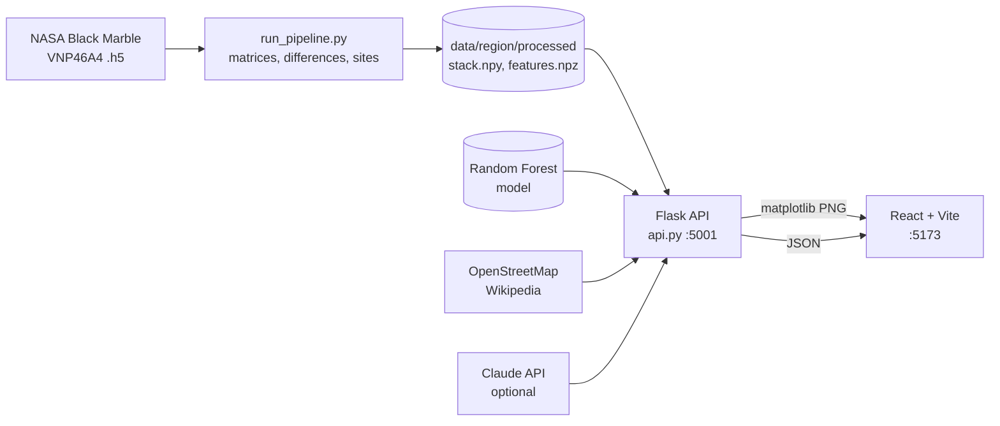

# Night-Light

**Detecting land-use change from night-time satellite imagery** (NASA Black Marble, 2013-2024).
Search any place or click the map, and the app shows how its lights changed, draws the
night-light matrices and their year-by-year differences with matplotlib, and writes an area
report on what kind of growth happened there.

> Version 1 prototype. Built and validated on Jharkhand, India. See [Limitations](#limitations).

| Feature | Where |
|---|---|
| Interactive map with search, coordinates and 271 detected sites | main view |
| **Generate graph**: matplotlib dashboard for the typed coordinates (matrix A, matrix B, difference matrix, the difference of *every* year, largest-increase hotspot) | *Matplotlib* tab |
| **Area report**: growth type over the last 10 years, with OpenStreetMap + Wikipedia context and an optional AI summary | *Area report* tab |
| Radiance timeline, hand labels, saved coordinates | other tabs |
| Method, results, how to read the graphs | *About* tab |

## Architecture



## Project structure

```
Night-Light/
├── backend/                 Python: pipeline, model, API
│   ├── api.py               Flask API (one server for everything)
│   ├── run_pipeline.py      matrices -> differences -> flagged sites
│   ├── train.py, evaluate.py   classifier training / cross-region test
│   ├── download_region.py   NASA Earthdata downloader (retries)
│   ├── matrix_difference.py standalone matrix-difference figure
│   ├── label_tool.html      browser tool for labelling sites
│   ├── regions.json         regions (bbox, tile, state name)
│   ├── src/                 config, window.py (measurements), figures.py (matplotlib),
│   │                        insight.py (area report), labels_bp.py, features, sites ...
│   ├── assets/              bundled label sheet and example figures
│   └── tests/smoke_test.py  API test on synthetic data
└── frontend/                React (Vite): map, tabs, graph generator, report
    └── src/components/      GraphLab, Gallery, AreaReport, About, MapView, ...
```

## Run it (two terminals, Windows PowerShell)

**Terminal 1: backend**

```powershell
cd backend
python -m venv .venv
.venv\Scripts\Activate.ps1
pip install -r requirements.txt
copy .env.example .env          # optional: add ANTHROPIC_API_KEY for the AI summary
python api.py                   # http://localhost:5001
```

**Terminal 2: frontend** (Node 18 or newer)

```powershell
cd frontend
npm install
npm run dev                     # open http://localhost:5173
```

Vite forwards every `/api/...` request to port 5001, so nothing else needs configuring.
Check the backend at `http://localhost:5001/api/health`.

## Data the API needs

The API reads processed files that are too large for git. For region `jharkhand` it expects:

```
backend/data/jharkhand/processed/features.npz
backend/data/jharkhand/processed/stack.npy
backend/data/jharkhand/processed/years.json
backend/outputs/jharkhand/sites.geojson
backend/models/jharkhand/site_classifier.joblib      (optional)
```

**Teammate / new machine:** copy those files from the project owner (Drive, USB).

**Rebuilding from scratch** (needs a NASA Earthdata token in `backend/.env`):

```powershell
cd backend
python download_region.py --region jharkhand        # ~13 files, ~1.7 GB
# put an India district GeoJSON at data/india.geojson (e.g. udit-001/india-maps-data)
python run_pipeline.py --real --region jharkhand    # writes processed data + label sheet
# label sites with label_tool.html, save as data/jharkhand/processed/label_sheet.csv
python train.py --region jharkhand --merge industrial,mining,urban_growth=change
```

**Moving from the old flat layout:** copy your old `data/`, `outputs/` and `models/` folders into
`backend/`, then run `python migrate_v1.py` once (it only copies). Make sure
`data/jharkhand/processed/` contains `stack.npy` and `years.json`; if not, rerun
`python run_pipeline.py --real --region jharkhand`.

Without the data the site still starts, and the bundled label sheet and figures keep the
*Saved coordinates* and project-figures views working.

## Using the new features

**Generate graph.** *Matplotlib* tab → type coordinates (or click the map) → choose a radius
(5-30 km) → **Generate graph**. The backend cuts that window out of the real matrices and draws:

- matrix A and matrix B (first and last years), and the **difference matrix D = B − A**
  (red = brighter, blue = darker; dashed line = top 5% of increases; yellow star = largest increase)
- the difference matrix of **every year** (each year minus the one before) on one colour scale,
  with a ring at the hotspot so you can see when it grew
- mean radiance per year and the mean year-to-year change, with the biggest rise marked

**Area report.** *Area report* tab → **Generate area report**. The backend measures the change, then
looks up the place (OpenStreetMap Nominatim), mapped land use around it (OpenStreetMap Overpass) and
nearby Wikipedia articles, and writes the report:

- with **Claude** if `ANTHROPIC_API_KEY` is set (the model only receives the measurements and the
  web context, and is told not to invent facts), or
- with a **rule-based writer** if there is no key or the call fails. The badge on the report says which.

Results are cached in `backend/cache/` for 7 days. If a web service is down the report still works and
lists what is missing. The report is an interpretation of lighting change, not a ground-truth survey,
and says nothing about legality.

## API

| Endpoint | Returns |
|---|---|
| `GET /api/health` | status, region, `model_loaded`, `ai_available` |
| `GET /api/meta` | region, tile, years, number of sites, radius limits |
| `GET /api/sites?type=&min_area=&limit=` | detected sites (GeoJSON) |
| `GET /api/analyze?lat=&lon=` | change score, label, probabilities, features, yearly radiance |
| `GET /api/timeseries?lat=&lon=` | yearly radiance |
| `GET /api/plot/difference.png?lat=&lon=&radius_km=` | matplotlib matrix-difference dashboard (PNG) |
| `GET /api/insight?lat=&lon=&radius_km=&ai=1` | area report (JSON) |
| `GET /api/labels`, `/api/lookup`, `/api/plot/site.png`, `/api/plot/overview.png` | hand labels and their plots |
| `GET /api/images/<name>.png` | pipeline figures |

Errors are always JSON: `{"error": "..."}`, for example when a point is outside the study area.

## Configuration (`backend/.env`)

| Variable | Purpose |
|---|---|
| `EARTHDATA_TOKEN` | download data from NASA (tokens last 60 days) |
| `ANTHROPIC_API_KEY` | optional, enables the AI summary |
| `ANTHROPIC_MODEL` | optional, default `claude-sonnet-5-5` |
| `CONTACT_EMAIL` | goes in the User-Agent of OpenStreetMap / Wikipedia requests |

Other regions: add an entry to `backend/regions.json` (a region must fit inside one 10° × 10° tile) and
run any script with `--region <name>`, e.g. `python api.py --region karnataka`.

## Tests

```powershell
cd backend
python run_pipeline.py --fake --region demo     # synthetic data, never touches real regions
python tests/smoke_test.py                      # API, graphs, report (web + AI mocked)
```

## Results

| | |
|---|---|
| Detected sites (Jharkhand) | 271 |
| Hand-labelled locations | 85 (45 no change, 30 urban growth, 6 mining, 4 industrial) |
| Rule alone: flagged sites that are real change | 65% |
| Binary classifier, spatial cross-validation | accuracy 0.73, macro F1 0.73 |
| Change class | precision 0.68, recall 0.80 |
| Industrial vs mining | not separable with night lights alone |

## Limitations

- Lights show *where* lighting changed, not *why*; road lighting and village electrification look like growth.
- ~500 m pixels: small sites are not resolved, and many mines are barely lit at night.
- 85 labels from one region and one annotator; the model is not validated outside Jharkhand.
- Thresholds were tuned by eye on Jharkhand.
- Nothing here says whether an activity is legal or illegal.

## Roadmap (Version 2)

More labels and a second annotator · Sentinel-2 daytime features · shape features to separate road
lighting from new buildings · validation on a second region · multi-tile regions · deployment.

## Troubleshooting

| Symptom | Fix |
|---|---|
| "API offline" in the sidebar | start the backend (`python api.py` in `backend/`); check `http://localhost:5001/api/health` |
| Graph says *outside the study area* | the point is outside the region's crop or its state border; try a point inside the state |
| `Data not ready` (503) | `stack.npy` / `features.npz` missing; see [Data the API needs](#data-the-api-needs) |
| Report shows "Could not load ... (OpenStreetMap)" | no internet or the service is busy; retry, the rest of the report still works |
| Report says "No ANTHROPIC_API_KEY" | add the key to `backend/.env` and restart, or ignore: the rule-based summary is used |
| `npm run dev` proxy errors | the backend is not running on port 5001 |

## Credits and data

NASA Black Marble VNP46A4 (Earthdata / LAADS DAAC) · Román, M. O., et al. (2018), *NASA's Black Marble
nighttime lights product suite*, Remote Sensing of Environment, 210, 113-143 · OpenStreetMap contributors ·
Wikipedia · district boundaries from udit-001/india-maps-data · map tiles © CARTO, OpenStreetMap, Esri.

Authors: [Your name] (data, model, API) · [Friend's name] (frontend) · Guide: [name] · [Institution]
